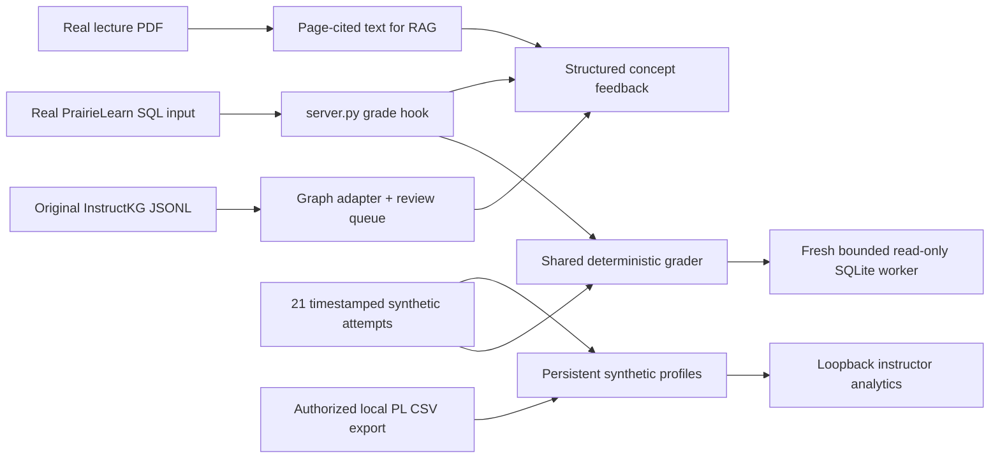

# SIIP — PrairieLearn × InstructKG SQL sandbox

A local, executable research prototype for SQL JOINs and NULL semantics. The student interface is **real PrairieLearn**. Its custom grading hook uses the same bounded SQLite evaluator as the synthetic analytics runner. No hosted UIUC course or real student records are used.

Verified on Intel macOS with Python 3.13.9, Docker Desktop 28.5.2 / Compose 2.40.3. Three questions, correct/incorrect UI submissions, feedback, retries, graph import, persistent synthetic profiles and analytics have been exercised. See [verification evidence](docs/VERIFICATION_REPORT.md) for precise status. Live LLM feedback and fresh InstructKG extraction are **BLOCKED**, not simulated successes.

## Open the running application

- [PrairieLearn](http://localhost:3000/pl): SIIP SQL → Fall 2026 Synthetic Sandbox → SQL Concept-Aware Feedback Sandbox.
- [Instructor analytics](http://127.0.0.1:8080): synthetic profiles, source-separated activity, graph review, feedback context comparison.

The graph contains 469 original judgments, 319 non-null relations and 121 named concepts. It covers multiple SQL lectures. Every original judgment remains unreviewed; eight separate developer provisional dependencies support the demonstration. The available real lecture PDF is preserved in its research checkout. It is not newly generated or published.

## Reproduce from this directory

Python ≥3.11 and Docker Desktop are required for the deterministic sandbox. Start Docker Desktop, then:

```sh
python3 scripts/bootstrap.py        # retrieve public repositories at recorded commits
python3 scripts/manage.py install # creates .venv, installs pinned lightweight PDF reader
make check
make init                         # rebuild course, both datasets, graph queue and 21 fixtures
make start                        # official PL image on 127.0.0.1:3000; analytics on 127.0.0.1:8080
```

Open PrairieLearn and click **Load from disk** (inside the top navigation menu on narrow windows). Wait for **Course sync successful**. Open the SIIP course instance, its assessment, then choose **Student view** from Dev User's menu. Question metadata changes require Load from disk; Python/HTML changes generally load on navigation. Restart the container after changing shared modules to clear process caches.

```sh
make test                         # meaningful deterministic, graph, feedback, profile and hook tests
make smoke                        # live HTTP checks; services must already be running
make evaluate                     # 63 paired fallback outputs, with 0 live inference claims
make fresh-preflight              # records exact upstream extraction blockers
make demo                         # starts services and rebuilds non-destructive fixture/evaluation outputs
make stop                         # stop only this project; retain both databases
make start
```

`make reset` saves the previous synthetic SQLite store, regenerates fixtures, and stops this project's services. It preserves PrairieLearn history. Use its **Regenerate your assessment instance** control for a fresh local demo. It never deletes Docker volumes or unrelated data.

## Architecture



Portable shared code lives in `prairielearn-course/serverFilesCourse/siip/`. Research repositories remain unmodified under `research/`. Course content, original/provisional graphs, question mappings, submission records and experiment outputs are separate. There is no PostgreSQL/Neo4j dependency for our integration package; PrairieLearn itself uses its bundled PostgreSQL database.

## Commands and configuration

All `make` targets also work as `python3 scripts/manage.py TARGET`. Targets include `check`, `install`, `init`, `start-pl`, `start-dashboard`, `seed`, `graph`, `test-sql`, `test-feedback`, `test`, `smoke`, `evaluate`, `fresh-preflight`, `stop`, `reset`, and `demo`.

The default package uses only the Python standard library. `requirements-dev.txt` pins pypdf for rebuilding lecture text. Optional extraction dependencies are separate in `infrastructure/requirements-pipeline.txt`; optional CUDA-only dependencies are in `requirements-gpu.txt`. Do not install the original all-in-one upstream requirements on this Mac.

`.env.example` contains names and safe defaults only. Environment variables must be exported for Python commands; Compose also reads its environment. Default `SIIP_FEEDBACK_PROVIDER=deterministic` makes no model requests. An already available local OpenAI-compatible server can be configured with `SIIP_FEEDBACK_PROVIDER=local`, `SIIP_LLM_BASE_URL`, and `SIIP_LLM_MODEL`. The container reaches a host-local server via `host.docker.internal`; host evaluation uses `127.0.0.1`. Run `scripts/evaluate.py --live-local` only against that local server. Remote/paid inference is not enabled by the CLI. No cost estimates are invented.

The PrairieLearn image is pinned by digest in `infrastructure/compose.yaml`, independent of the separately audited source commit. The image has no embedded Git checkout, so its source SHA is not asserted. Docker data is in the project-scoped `pl-postgres-data` volume mounted at the image's actual `/var/postgres` path.

## Real PrairieLearn attempts → profiles

The immediate grade/feedback is displayed within PrairieLearn and stored in its submission history. Longitudinal profiles use an explicit source adapter; question code does not guess a student UID.

For this local demo only, download **Downloads → all_submissions.csv** from the SIIP assessment and run:

```sh
.venv/bin/python scripts/import_pl.py artifacts/pl_all_submissions.csv --local-synthetic-only
```

Only the local `dev@example.com`, known HW1 and three question IDs are accepted. They map explicitly to synthetic **S003**. Normalized records omit name/UID/UIN, preserve PL submission IDs and source, recompute results, and check agreement with PrairieLearn scores. Reimports are idempotent. This is a tested CSV integration, not a production API connection or automatic push from grading code. Refresh the dashboard after import.

## Troubleshooting

- Docker daemon unavailable: start installed Docker Desktop; `make check` reports the failure.
- Port conflict: use `lsof -iTCP:3000 -sTCP:LISTEN` / port 8080 to identify the owner. Do not terminate an unrelated service. Adjust loopback ports and documented URLs together if necessary.
- No course: Load from disk and inspect the job log. No upstream core patch is needed.
- Grade click after editing: let the input update settle, then click Save & Grade. Confirm a new submitted-answer panel appears.
- Shared code stale: `docker compose -f infrastructure/compose.yaml restart prairielearn`.
- Lost history: verify the `/var/postgres` named volume. `make stop/start` preserves history; never use `down -v` for normal shutdown.
- Fresh extraction cannot install on Intel Python 3.13: actual dependency dry-run has no compatible torch wheel. Use a supported separate extraction environment and an authorized provider; see [InstructKG guide](docs/INSTRUCTKG_INTEGRATION.md).
- No API key: the entire deterministic sandbox still works; feedback explicitly logs fallback status.

## Research boundaries and documentation

[Demo](docs/DEMO.md) · [audit](docs/REPOSITORY_AUDIT.md) · [architecture](docs/ARCHITECTURE.md) · [PrairieLearn integration](docs/PRAIRIELEARN_INTEGRATION.md) · [feedback](docs/FEEDBACK_DESIGN.md) · [profiles](docs/STUDENT_PROFILE.md) · [security](docs/SECURITY_AND_PRIVACY.md) · [experiment plan](docs/EXPERIMENT_PLAN.md) · [deployment](docs/DEPLOYMENT_GUIDE.md) · [human actions](docs/HUMAN_ACTION_REQUIRED.md) · [progress](docs/PROGRESS.md).

Synthetic results demonstrate technical behavior, not learning improvement. Instructor review, research authorization and a hosted sandbox are future requirements. This is not production-ready. Local copied lecture text/graph evidence and raw PL exports are excluded from integration Git tracking; do not redistribute course material without permission.
