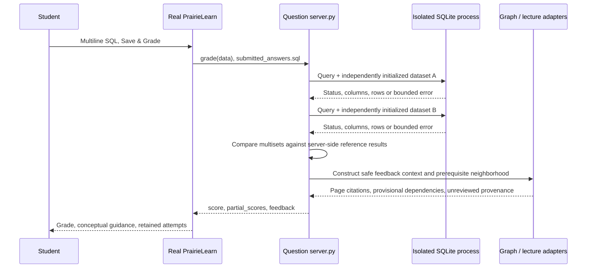

> Phase 1 historical record. For current Phase 2 status, see [CURRENT_STATUS](handoff/CURRENT_STATUS.md). Counts and blockers below describe the earlier snapshot.

# Implemented architecture

The integration is a modular Python package bundled in PrairieLearn `serverFilesCourse/siip`, not a rewrite of either research repository. Python/SQLite/JSON suffice for the prototype. The official PrairieLearn container owns its separate PostgreSQL database and actual submission lifecycle.

## Data flow

`grader.py` owns correctness. `feedback.py` diagnoses observed output and constructs distinct contexts, while `graph.py` adapts the real InstructKG A/B schema. `pl_bridge.py` is the supported platform boundary. Each question is a thin import of this bridge. The two SQL datasets have no foreign-key constraint on employee.department_id because unmatched references are intentional.

`sql_worker.py` runs via Python `-I` in a temporary directory with a minimal environment. It initializes in-memory tables, enables query_only and a SQLite parser-level authorizer, then executes one statement. It cannot load extensions, invoke arbitrary functions or read unrelated tables. Progress callbacks and parent timeouts bound recursive/expensive reads. See SECURITY_AND_PRIVACY.md for limits and OS distinctions.

## Persistence boundaries

- Course metadata: versioned JSON and question HTML/hooks.
- Questions/reference SQL: server-only package data; not emitted in params, correct_answers, feedback or model contexts.
- Original model graph: byte copy of the pinned upstream JSONL, SHA256 and line IDs.
- Review decisions: optional overlay; original records/directions retained.
- Provisional graph/mapping: explicitly developer-created; no instructor approval asserted.
- Lecture evidence: pypdf native page text with PDF checksum; not fresh InstructKG extraction.
- Student records: `artifacts/synthetic.sqlite3`, schema_version=1; source and assessment IDs separate from model output.
- Evaluation: paired contexts and outputs, model/prompt/dataset versions and actual timing.
- PL history: project Docker volume at `/var/postgres`, separate from the synthetic store.

`SubmissionRepository` is the replaceable storage boundary for PostgreSQL. `ConceptGraph` exposes edges, evidence and bounded prerequisites and can later be backed by Neo4j. The source protocol separates synthetic fixtures, authorized local exports and documented read-only API access. There is no unrestricted submission-write endpoint.

## Identity and update behavior

Question hooks never read assumed UID/UIN fields. The local export importer maps the single artificial Dev User to S003 through a narrow allowlist. Five UI submissions are imported separately from 21 fixture attempts. A new fixture/dashboard attempt updates profiles immediately. A new PL attempt updates PL immediately, then updates our profiles after an explicit export/import. An authorized API polling deployment is future work; the read adapter exists but no production call was made.

## Local process configuration

Compose uses one pinned official PL image with loopback binding, read-only course mount, no Docker socket and no privileged mode. The instructor dashboard binds only 127.0.0.1:8080 and is intentionally unauthenticated synthetic local tooling. Optional local model feedback has an eight-second HTTP timeout; any provider/validation failure preserves the deterministic grade. Default mode makes no network inference call.
