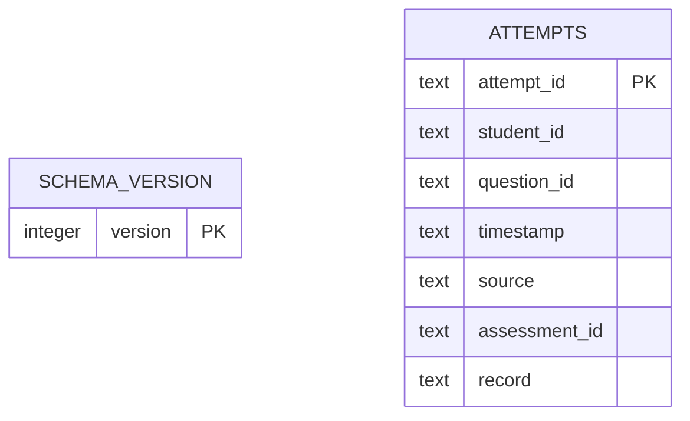

# Persistent data model

The integration's `SubmissionRepository` uses `artifacts/synthetic.sqlite3` (override SIIP_DB_PATH for isolated tests). PrairieLearn's PostgreSQL is a separate Docker volume at `/var/postgres` and is never used as an arbitrary injection API.

`schema_version` is an applied-migration journal with entries 1 and 2 (highest 2). The follow-up additively creates `sync_checkpoints(scope TEXT PRIMARY KEY, state TEXT NOT NULL)` without modifying existing attempts. Checkpoint state contains normalized-snapshot hash/counts/time, not raw identity or SQL. The attempts(student_id,timestamp) index supports histories. JSON retains grade/evidence/diagnosis/concepts, feedback/version metadata and available external submission links. Original identity columns are not copied. Required fields and allowed external numeric ID fields are checked before insertion; unsupported extras are rejected.

Attempt IDs are immutable idempotency keys. Collision checks include identity, question, SQL, normalized timestamp, source, assessment and external scope/score. Preparation occurs outside the write transaction; BEGIN IMMEDIATE then rechecks existing rows to resolve concurrent duplicate writers. Any insert/collision exception rolls the whole batch back. Connections are closed explicitly; no provider call is performed while holding the write lock.

Records sort by UTC timestamp then attempt ID. Mastery uses the latest correct/semantic-error result per linked question, with Beta(1,1) smoothing. Ingestion does not convert compilation failures into concept mastery evidence. As-of retrieval avoids using future persisted attempts in earlier feedback.

SQLite is suitable for this local synthetic scale. Multi-user deployment needs an approved repository backend, concurrency/retention policy and transactional integration design. Future PostgreSQL migration should preserve immutable event provenance, not copy an uncontrolled JSON dump of identities.

The synchronizer passes an expected prior checkpoint into process_many; BEGIN IMMEDIATE verifies it before attempts/checkpoint are committed together. Any insert, score/collision or checkpoint error leaves the previous committed state intact. Polls do not delete absent records. Optional commit statistics count actual new inserts inside the transaction.
