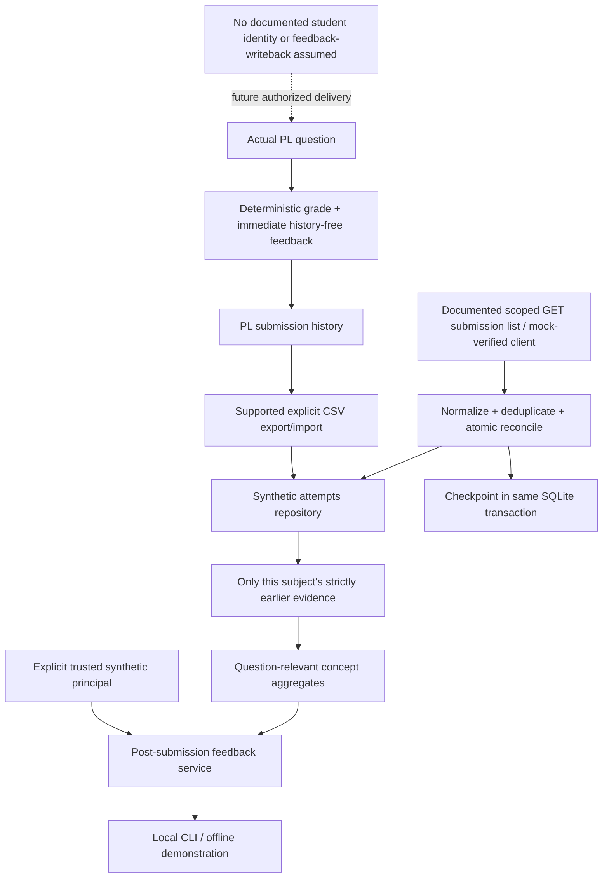

# Submission, profile and personalized-feedback lifecycle

## Implemented boundaries

The PrairieLearn question hook has **no trusted student identity or historical profile**. It grades SQL, constructs question/concept/KG context and returns immediate feedback. Student-supplied identity/mastery fields are ignored. No user UID is inferred from params, submitted answers or a variant. The hook does not query educational records.

Historical feedback is a separate **post-submission local synthetic service**, `siip.personalization.feedback_for_attempt`. Its trusted caller must supply a `FeedbackPrincipal` from `synthetic_principal(..., authorized=True)`. A principal is an in-process authorization context, not a signed web token or real institutional authentication. The service is not exposed as an unauthenticated HTTP endpoint. A caller-controlled JSON dictionary is not accepted as a principal.



Solid arrows are implemented. The API client is verified against local mock transports and the official contract, not an authenticated live PL API. The existing browser/CSV path remains the actual PL E2E. There is **no automatic feedback writeback to PL**, authenticated hosted service, webhook or incremental server cursor invented by this project.

## Evidence selection and minimization

The service resolves an attempt using **attempt ID AND authorized synthetic student ID** in the repository query. Cross-student and nonexistent attempts return the same access-denied error. Only S001–S005 are supported. Before constructing history it uses the current attempt's normalized UTC timestamp as an **exclusive** cutoff. Current, equal-time, future and other-subject attempts are excluded. Equal timestamps are excluded rather than assigning an unsupported causal order.

The existing profile computes Beta(1,1) smoothing over the latest eligible correct/semantic-error result per linked question; syntax failures alone do not become mastery evidence. This remains an unvalidated descriptive heuristic. `minimize_mastery` admits only relevant concept names, bounded numeric estimate, eligible-question count and evidence count. It drops identity, historical SQL, free text, attempt IDs, timestamps and unrelated concepts before the model boundary. The current submitted SQL remains an intentional tutor input.

A deterministic history sentence now changes with weak versus positive prior evidence. The same current SQL/grade under contrasting S001/S002 histories produces different feedback; no model is required. New tests also verify API snapshot → profile → authorized feedback, prior-only cutoffs, cross-subject denial, minimization and late-arrival replay. `scripts/demo_personalization.py` reproduces this in a disposable database and writes ignored evidence. It never changes the accepted store.

The returned evidence receipt records cutoff/policy, prior-attempt and eligible-concept counts, profile version, synthetic scope, delivery boundary and unchanged-grade status. It contains no historical SQL or subject identifier. Feedback is computed for an authorized read; it does not overwrite immutable submission grades or pretend the regenerated text was the feedback shown at original submission time. Late historical arrivals can change a subsequent replay; the receipt makes its event-time policy explicit.

```sh
.venv/bin/python scripts/demo_personalization.py
.venv/bin/python scripts/personalize.py --student S003 --attempt local-pl-15 --ack-local-synthetic
```

The second command is explicit synthetic operator tooling. It is not a learner-login mechanism. No live inference is invoked by either command.

## Supported synchronization and consistency

`sources.py` uses the documented GET `/pl/api/v1/course_instances/:id/assessment_instances/:id/submissions` and `Private-Token` header. Current official docs/source provide a complete list, not a timestamp/ID cursor. `SubmissionSynchronizer` polls that list, validates the entire bounded response and reconciles stable IDs. It does not discard lower IDs or older timestamps. Origin/course-instance/assessment-instance scope is hashed into canonical API attempt IDs; keep the configured base URL stable because hostname aliases cannot be inferred to be the same PL deployment.

Only an explicitly authorized assessment and explicit raw-user-ID → synthetic-ID mapping are allowed. Team records, foreign assessment scope, malformed IDs/answers/grades and unmapped identities fail closed. Raw name/UID/UIN, true answer and unrelated response fields are discarded. Pending null grades are deferred and revisited, never treated as incorrect. Completed API scores must agree with the deterministic local grade.

New attempts and checkpoint commit in a single SQLite transaction. A compare-and-set check rejects stale concurrent polls; retry by refetching. Repeated snapshots insert zero duplicates. Checkpoints are observations of the last successful snapshot, **not a high-water filter**. Failures do not advance them; missing remote rows do not delete local history. Changed completed submissions/regrades are rejected for explicit reconciliation rather than silently rewriting grades. Poll/response limits intentionally bound this small prototype; no course-load scalability claim is made.

CSV remains intact. CSV instance **numbers** are not database IDs. Ambiguous CSV/API overlap is rejected until an operator supplies an explicit submission-ID → existing CSV-attempt-ID map in the exact authorized scope. Matching student/question/SQL/time/score/submission ID is required; the original CSV record/source is preserved and counted once. Without a verified scope map, the system refuses to guess.

## Future authorized hosted integration

A hosted application must authenticate a learner/instructor through an approved institutional mechanism, authorize subject/course access server-side, map identity in a protected store, and pass a trusted principal to the feedback service. Do not accept student IDs or serialized principals as proof of authority. Minimize access-token privileges, retention and logging; the PL API token inherits the account's permissions.

The safe default is a separate authenticated post-submission feedback view. Immediate personalized PL delivery requires a **documented, approved identity and rendering contract**; no such hosted contract is verified here. Instructor/research approval, privacy/retention controls and hosted network/runtime checks remain prerequisites. No CS418 or real learner records were accessed.

Sources inspected: [official API docs](https://docs.prairielearn.com/api/) and pinned PL `SubmissionDataSchema`/route source at eaaa918. These support read access; they do not establish a feedback-writeback API or identity in question hooks.

Feedback provenance is explicit in new outputs: PL hook=`prairielearn_hook_immediate`; stored analytics recomputation=`local_analytics_recomputed`; authorized read receipt=`authorized_post_submission_replay`. CSV/API ingestion intentionally recomputes an analytics hint and does not claim to preserve the original PL wording. Previously stored records can lack the field and retain their original prompt/version metadata.
