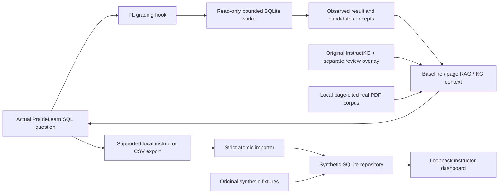

# Implemented system overview

A modular monolith is bundled in `prairielearn-course/serverFilesCourse/siip`. Three thin `server.py` hooks call its deterministic grader and optional feedback layer. A separate loopback dashboard uses the same package and SQLite repository. PrairieLearn itself is the official digest-pinned application and owns its own PostgreSQL history. No PL core patch, Neo4j service or duplicate KG extractor is present.

The UI-to-analytics link is explicit export/import. It is not an undocumented server.py student-identity hook or automatic hosted API push. New code preserves this honest boundary. The E2E driver exercises that entire supported path, including export and analytics count agreement.

Public CI uses separately labeled original contract graph/lesson fixtures and tests the adapter contract. Local research tests inspect the real 469 judgments. Full concept extraction and live feedback need approved model access. See component docs for actual files and the current handoff for evidence/status.

## Cross-validation follow-up

The [personalized-feedback lifecycle](PERSONALIZED_FEEDBACK_LIFECYCLE.md) adds a scoped, mock-verified API snapshot reconciler and an authorized post-submission synthetic feedback service. The immediate PL hook remains anonymous/history-free. Strictly prior concept aggregates can now change local rule feedback for identical current SQL under distinct histories. No new production service, speculative identity hook, live inference or PL feedback-writeback API is introduced.
