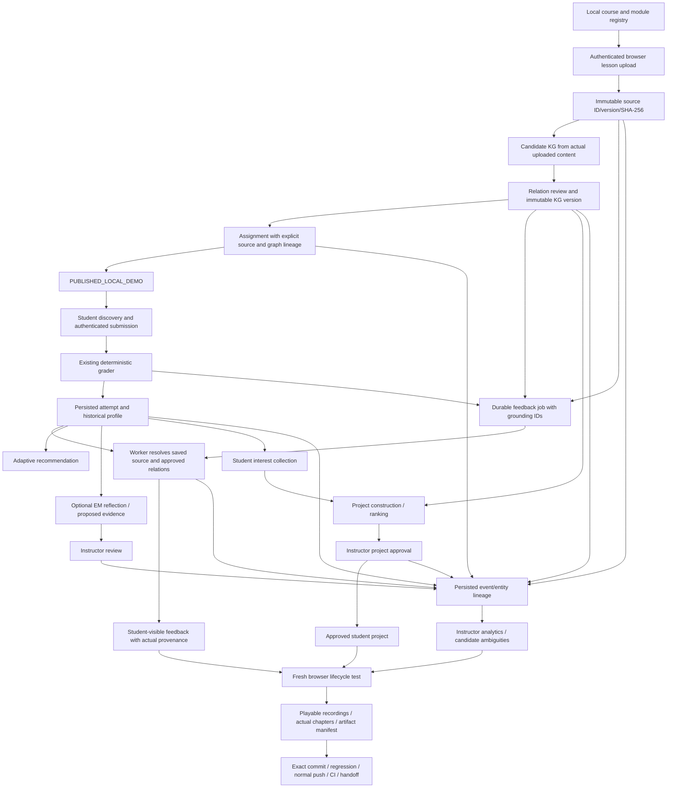

# Integration dependency graph

Main owns the router, shared schema/config/authentication, queue/feedback grounding, deployment, final regression, and release. Agents commit isolated owned modules. Integration follows dependencies; source existence is not an acceptance test.

Integrated update: the critical path through uploaded source, reviewed fixture KG, explicit assignment grounding, student grade/queued deterministic feedback, history/recommendation, EM review, interest/project approval and entity lineage was executed by fresh Chromium and passed in 44.005 seconds (`artifacts/release/full-browser-release.log`). A separate actual uploaded-source local Ollama extraction succeeded during the long professor recording. The remaining release nodes are final long-video completion/validation, final post-change regression, remote commit/CI and package handoff. Original InstructKG and native Docker/PrairieLearn remain blocked/unverified; neither is implied by the successful local SIIP path.

| Producer → consumer | Required shared contract | Owner |
| --- | --- | --- |
| Course/module → upload | `course_id`, `module_id`, valid parent association | Authoring registry + main router |
| Upload → extraction | `source_document_id`, `version`, `sha256`, original filename, bytes actually read, UTF-8 text, status | Authoring / extraction |
| Review → assignment | Explicit `graph_id`/`graph_version`; saved reviewed graph; validated node IDs and matching source/course/module | Extraction + main |
| Assignment → student | Local publication status/time; known deterministic question; source and graph versions; no hidden reference SQL | Authoring/student + main |
| Student → store | Trusted synthetic principal; replay-stable submission key; assessment ID; SQL; UTC timestamp | Student + main |
| Store → feedback queue | Attempt ID, student ID, public grade, immutable grounding IDs/digest; no hidden datasets/reference solutions | Main queue/feedback + student adapter |
| Worker → feedback UI | Durable job status, actual generation provenance and timestamps, safe feedback projection | Main |
| Attempt → EM | Owner-checked attempt; prompt/response IDs; proposed behavioral evidence independent of technical mastery | Existing EM service + main |
| Interest/profile → project | Persisted selected interest; current technical profile; prerequisites; staged/ranked validated templates | Main project integration |
| All entities → observability | Stable entity/course/assignment/correlation IDs; actual status/time/source type; existent artifact refs | Analytics + main |
| Integrated UI → recordings | Browser input and state transitions; exact produced files; actual video timecodes | Recording owner |

Use isolated temporary state for component tests. Only main operates the final database, worker, Docker/PrairieLearn deployment, model configuration, and final recordings. Shared directory locks in the JSON registry protect threads/instances in one process only; final demonstration uses one authoring server process.

Release ordering: cherry-pick authoring contracts, extraction/review contracts, and observability; integrate router plus assignment-grounded feedback and interest selection; execute full regression and fresh browser lifecycle; record/validate the final scenario; publish source and inspect exact remote CI. Recording infrastructure should be prepared in parallel but cannot certify a pre-integration build.
