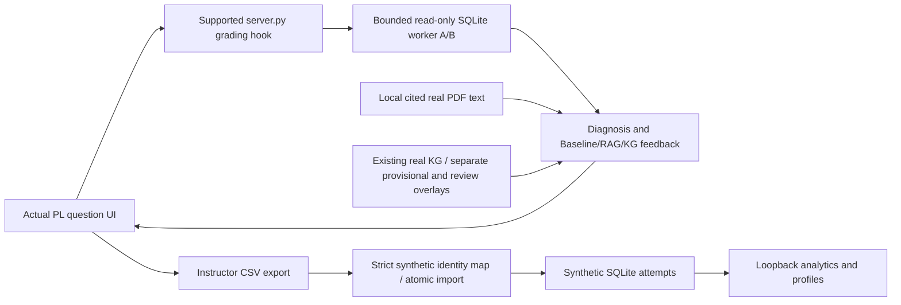

# External review packet — SIIP Phase 2

## Section 1 — Executive Summary

A working local three-question PrairieLearn SQL course now has hardened deterministic grading, optional structured feedback, real graph loading, explicit export/import persistence and synthetic analytics. The original 43 tests were independently reproduced and40 added (83 distinct total). Actual browser E2E and exact-record restart checks pass. Original integration code is published to the authorized public repository; protected research/material/runtime artifacts remain local.

Live feedback and generative extraction are BLOCKED by explicit user instruction to keep inference blocked/no paid usage. CPU dependency isolation imports the real upstream pipeline, but actual PDF ingestion timed out after600 seconds. No completed fresh KG, instructor review, hosted deployment or learner-effect evidence is claimed.

## Section 2 — Repository Information

Repository: https://github.com/IanJ332/insructkg_sandbox (verified PUBLIC). Branch: `engineering/phase2-hardening`. Implementation snapshot (CI evidence below is keyed by exact SHA): `11b803ed91a91520d053427acf79740607c81eff`; final documentation commits may follow. Resolve final branch head with `git rev-parse HEAD` or the branch URL. [verification.json](verification.json) records run/SHA evidence; no circular claim that a document contains its own final commit ID.

Source: `prairielearn-course/serverFilesCourse/siip/`, three `questions/*/server.py` hooks, `scripts/`, `tests/`, `research_tests/`, `infrastructure/`, `.github/workflows/`. Config: `.env.example`, pyproject.toml, pinned requirements-dev.txt, compose.yaml and extraction-cpu.lock. Runtime package uses stdlib; dev tooling/pypdf/Playwright are separate. Exact upstream and image pins: [dependency inventory](../engineering/DEPENDENCIES.md). Jeffry c34a778 and reference ade6263 are unmodified ignored checkouts, not vendored. No blanket redistribution license is assumed.

## Section 3 — Implemented Architecture

PrairieLearn stores its own submission history in bundled PostgreSQL. The arrow through CSV is explicit and supported; there is no automatic identity inference or invented hosted push API. Default feedback is labeled deterministic fallback. [Contracts](../architecture/INTEGRATION_CONTRACTS.md) describe actual error/status semantics.

## Section 4 — Feature Inventory

| Feature | Status / files | Verification | Limits |
|---|---|---|---|
| PL questions/lifecycle | PASS; questions/*, pl_bridge.py | Actual browser three questions,5 submissions and corrections | Local official pinned image only |
| SQL correctness/safety | PASS; grader.py, sql_worker.py | Two datasets, bag/NULL/alternative/adversarial/deadline tests; actual PL grade | Small SQLite scope; no formal sandbox proof |
| Existing KG | PASS Mode A; graph.py, review scripts | Two real-data tests,469 judgments / 121 nodes, direction/provenance | Original unreviewed;8 separate developer provisional edges |
| Fresh KG | PARTIAL/BLOCKED; extraction wrapper/container | No-network upstream import pass; ingestion exit124 | No fresh stage outputs/model calls |
| Feedback | Contract PASS/live BLOCKED; configuration.py, feedback.py | Local fake HTTP normal/errors/filter tests;63 fallback comparisons | No live quality/leakage proof; bounded synchronous hook |
| RAG | PASS retrieval mechanics; feedback.py, prepared corpus | Cited term retrieval and context tests, real local PDF provenance | No semantic relevance benchmark; public fixture distinct |
| Storage/CSV | PASS; store.py, ingestion.py | Rollback/concurrency/idempotence/minimization; actual CSV import | Only explicit synthetic Dev User mapping |
| Profiles/analytics | PASS local behavior; store.py, dashboard.py | Five students/37 records, isolation/API/UI tests | Beta heuristic, no validated mastery/auth/public access |
| Persistence/local delivery | PASS; manage.py, persistence_probe.py | Exact 15 PL IDs/37 record hashes survive restart; wheel inventory | No hosted restore/load SLA |
| CI/security | Actual run evidence in verification.json | Two-Python test/build; scanners; slow PL E2E workflow | Scans scoped; real corpus never uploaded |

## Section 5 — Test Results

Original command `.venv/bin/python -m unittest discover -s tests -v` passed43/43 before changes. Expanded `manage.py test-public` passes81/81 (41 retained +40 new); `manage.py test-research` passes2/2 moved original graph tests. **83 distinct, 83 passing, 0 failed, 0 skipped** in final local checks. The81 also passed against local research data. Do not sum repeated executions into test coverage. Final public run55.002sec; raw logs are local artifacts/phase2/{baseline-tests,expanded-tests,final-public-tests,research-tests}.log.

`manage.py quality`, Bandit, pip-audit, `manage.py build` and wheel inspection pass in their documented scope. Five live HTTP checks pass. `tests/e2e/prairielearn_flow.py --ack-local-synthetic` exercises actual grade/feedback/retry/export/import/analytics and passes; e2e/result.json records submission DOM IDs11–15,37 records and zero model calls. Browser screenshots/trace stay local. `persistence_probe.py before/after` compares exact IDs/hashes through stop/start, PASS.

Meaningful failed experiments are retained in [issue log](../history/ISSUE_LOG.md): environment socket denial, intermediate HTTP handling defects, PL cold-start readiness, score-selector whitespace failure after five successful real attempts, actual upstream ingestion timeout. The first four were resolved and rerun; ingestion remains FAIL. Live inference is blocked, not a skipped green test. GitHub run links/conclusions are in verification.json; inspect actual workflow output rather than trust this prose.

## Section 6 — Research Integration

Actual reused InstructKG is unmodified Jeffry main.py and its ingest→concept/roles→clustering→packets→judgment design. Mode A consumes its existing A/B/name/role/relation/evidence/_meta JSONL, retaining direction/source/raw records and review overlay. The historical graph is not a fresh result. No code-only synthetic graph is passed off as extraction. Mode B import works in CPU Linux; ingestion produced no chunks before timeout; later stages were not executed.

Question mapping and diagnosis assign candidate concepts explicitly; beta profiles aggregate evidence per student using prior timestamps. These are hypotheses about gaps, not causal diagnosis. Baseline gets question/SQL/grade, RAG adds retrieved cited pages, KG adds clearly labeled unreviewed/provisional relationships and prior profile context. **All three modes currently use deterministic fallback in comparison runs.** Provider tests are mocked local HTTP contracts. No live generative response is claimed. Real PDF/graph content is kept out of public Git/wheel/CI.

## Section 7 — Engineering Risks

Security: loopback Host/Origin checks and strict JSON are useful but no authentication. Privacy: synthetic-only IDs, minimized importer fields and allowlisted logs; real identity/retention/access design remains. SQL: bounded separate worker, authorizer/parser and multiple datasets; resource bounds vary by OS and are not formal isolation. LLM: filters reject obvious SQL leakage/invented references, not semantic attacks; synchronous calls still consume bounded grade latency.

Dependencies: Linux isolation resolves imports, but parsing timeout, mutable OS/model downloads and upstream resume/orphan-card/OCR concerns persist. Consistency: atomic batch validation/commit and duplicate recheck protect writes; batch feedback sees preexisting history, not sequential uncommitted attempts. Scalability: SQLite, serialized local POST and naive profiles have no course-load benchmark. PL: official lifecycle is inspected and local browser verified; hosted network/identity restrictions unknown. Operations: tested restart and preserved backups; no automated restore drill, HA or hosted alerting. Pip/Bandit scans do not audit the full official PL image/research stack.

## Section 8 — Design Decisions Requiring Review

Review modular monolith/stdlib packaging versus a separate service only when deployment requires one; current layout minimizes operational duplication. Review SQLite bag-equivalence across two fixtures: practical for the three tasks but cannot prove general query equivalence. Review explicit CSV identity mapping: honest and testable locally, operationally manual. Review bounded synchronous optional feedback versus future async: no hosted latency measurements yet.

Review preserving contradictory graph directions in overlays, provisional mappings and simple beta profiles: transparency is preferable to silently altering research evidence, but instructor validation is missing. Review synthetic public fixtures versus local research tests: they deliberately prove different things. Review no blanket license/material publication and narrow scanner exceptions. [ADR index](../history/DECISION_LOG.md) gives rationale and consequences.

## Section 9 — Remaining Implementation Work

| Priority/goal | Reason and prerequisites | Proposed changes/files | Acceptance / complexity / blocker |
|---|---|---|---|
| P0 live feedback | No actual model evidence; changed user instruction and approved model needed | feedback/config/evaluate; bounded canary and frozen comparisons | Actual 3 modes,unchanged scores, usage/error evidence; medium; explicitly blocked |
| P0 fresh extraction | Ingest timeout and no fresh KG | Profile unchanged upstream via wrapper/CPU image; authorized later stages | Actual stage counts/checksums/runtime and reviewable graph; high; model stages blocked |
| P1 reliability | No target-load/restore/hosted-latency evidence | Worker/store/tests/ops; measure then async only if needed | Resource/grade budgets and isolated restore proof; medium/high; target facts |
| P2 hosted/legacy | No course access or backend contract | Documented source adapters, identity policy, isolated backend comparison | Authorized synthetic hosted E2E/reuse decision; high; institutional/repository access |
| P3 graph/mastery/study | No instructor validation or learning outcome evidence | Review rubrics/calibration/preregistered experiment | Reviewed provenance and valid empirical analysis; high; instructor/research decisions |

The [standalone plan](NEXT_IMPLEMENTATION_PLAN.md) gives all ten required fields per task, explicit tests/dependencies/risks and autonomous versus human responsibilities. EM/adaptive projects are later research scope, not existing functionality.

## Section 10 — Questions for Independent Review

1. Are the architecture and interfaces appropriate for the actual local/hosted constraints?
2. Does the explicit PL→CSV→atomic import→analytics path satisfy the requested E2E workflow, and where must automation change for a pilot?
3. Are the 83 distinct tests, actual browser checks, restart and CI claims supported by the linked/sanitized evidence?
4. Are SQL authorizer/process/resource boundaries adequate on the target OS, and what adversarial cases remain?
5. Is the feedback design pedagogically and technically sound, given zero live inference and limited leakage filters?
6. Is graph loading/direction/provenance faithful to InstructKG, and are unreviewed/provisional edges clearly separated?
7. Are profile summaries defensible descriptive evidence, and what calibration is required before calling them mastery?
8. Is the deployment/identity/optional-feedback design compatible with authorized hosted PrairieLearn?
9. Are any components redundant, particularly if the original backend becomes available?
10. What is missing before a real pilot, including graph review, live quality, consent, power, retention and monitoring?
