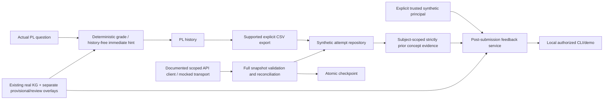

# External review packet — Phase 2 cross-validation follow-up

## Section 1 — Executive Summary

The accepted local prototype is extended incrementally. It now has authorized **synthetic post-submission** history-aware feedback, supported-API snapshot reconciliation contracts, actual non-generative CPU chunking profiles, correct local-backend credential planning and a pinned future Windows GPU guide. Existing PL/CSV/grade/KG behavior is preserved; source provenance and learner claims are more explicit.

All 121 distinct tests pass locally (119 public +2 real graph), retaining the accepted 83 and adding38. Actual PL browser E2E and exact20-ID/42-record restart pass. Live generative inference, authenticated live PL API polling, Windows hardware execution, original-settings VLM extraction and real learner/hosted deployment remain unverified/blocked. No CS418, real records, paid API, production deploy or PR merge occurred.

## Section 2 — Repository Information

Repository: https://github.com/IanJ332/insructkg_sandbox (public). Branch: engineering/phase2-hardening. [Draft PR1](https://github.com/IanJ332/insructkg_sandbox/pull/1) remains unmerged. Implementation snapshot: **47626e6c0326fb0cee59e61beceaebd76f071c6a**. Documentation-only evidence commits may follow; resolve final branch head separately. verification.json links actual workflow SHAs/results, including retained previous-phase evidence.

Primary package: prairielearn-course/serverFilesCourse/siip/. New boundaries: personalization.py, synchronization.py, extraction.py. Existing feedback.py/store.py/sources.py are hardened incrementally; PL hooks remain thin. New CLIs: personalize.py, demo_personalization.py, sync_pl.py, profile_ingestion.py, verify_ingestion.py and check_local_model.py. Configuration: .env.example, scope example, infrastructure/windows/*, pyproject.toml, exact dev/CPU locks and digest-pinned PL Compose. Version 0.2.1 is a prepared code-only distribution, not a published release tag.

Upstream source pins remain unchanged: Jeffry c34a778, reference ade6263, audited PL source eaaa918; the official runtime image digest is separate. No upstream code is vendored/modified. Real PDF/text/graph, outputs, databases, model caches, tokens, traces and screenshots stay ignored. No blanket licensing rights are assumed.

## Section 3 — Implemented Architecture

API arrows are implemented contracts, not a claim of authenticated live connectivity. CSV is still the actual PL E2E path. No identity is guessed from question params/answers, no feedback-writeback API is invented and no student-facing hosted auth service is deployed. See the full [lifecycle](../architecture/PERSONALIZED_FEEDBACK_LIFECYCLE.md).

## Section 4 — Feature Inventory

| Feature | Status/files | Verification | Limits |
|---|---|---|---|
| Immediate question/concept feedback | PASS; pl_bridge.py/feedback.py | Actual PL 3 questions, five new correct/incorrect/correction submissions | History-free; no trusted student identity in hook |
| Historical synthetic feedback | PASS local; personalization.py + minimized context | Contrasting histories/same current SQL change deterministic text; strict cutoff/isolation/provider-context tests and demo | Post-submission only; local principal is not institutional auth |
| API sync | PASS contracts; sources.py/synchronization.py/store.py | Supported GET/schema, subject map, duplicates, late/incremental/pending, errors/permissions, CAS/rollback/restart/CSV alias tests | Actual authenticated API NOT_RUN; full snapshots bounded; no hosted/real identity support |
| CSV/analytics | PASS; original importer/dashboard | Actual export/import37→42 records;5 students,22 correct | Derived feedback recomputed locally; not the exact original PL hint |
| Grading | PASS; unchanged deterministic worker | All retained SQL safety/bag/NULL/A-B tests and actual PL | SQLite prototype scope; no formal kernel sandbox proof |
| Existing KG | PASS Mode A; graph.py |469 judgments/121 nodes, preserved direction/provenance and tests | All original judgments unreviewed;8 separate provisional edges |
| Fresh CPU ingestion | PASS named variant; wrapper/profiler/verifier | Original chunker,13 chunks native/Tesseract,17 page backends,16 Tesseract-cited pages; final generation guard 0attempts | Not original VLM settings, not a KG; semantic OCR review pending |
| Windows/local model readiness | Contract/recipe PASS; hardware NOT_RUN | Official-version pins, dry-run no-key planning, metadata GET-only and JSON-mode/model/limit/error tests | No model selected/served; Responses extraction compatibility separate |
| Persistence/operations | PASS; manage.py/probe | Clean PG stop contract + exact42 records/20 PL IDs survive restart | Stale-socket failure retained; no hosted/load/restore SLA |
| CI/security/build | Actual links in verification.json | Two-Python119-test runs, scoped scans, code-only26-file wheel, slow actual PL workflow | No raw course/research artifacts in public CI; no production deployment |

## Section 5 — Test Results

Baseline independently reproduced before changes:81public tests +2 real graph =83accepted tests. New test_followup.py has38cases:9 personalization,22 API/sync including combined lifecycle,5 local backend/metadata contracts and2 shutdown cases. Total119 public +2 real graph =**121 distinct,121passing,0failed,0skipped**. Repeated runs are not extra coverage. Exact local final public run47.941s; research2 tests0.077s.

Commands: `manage.py test-public`, `python -m unittest discover -s research_tests -v`, `manage.py quality`, Bandit, pip-audit, `manage.py build`, actual Playwright E2E, smoke and persistence_probe before/after. Evidence is under artifacts/followup/{public-tests-final,research-tests-final,quality,bandit,dependency-audit,build-final,e2e,persistence-restart}.log plus JSON scans/profiles. Final implementation-snapshot [CI](https://github.com/IanJ332/insructkg_sandbox/actions/runs/38662343534), [Security](https://github.com/IanJ332/insructkg_sandbox/actions/runs/38662343514) and [actual PL E2E/restart](https://github.com/IanJ332/insructkg_sandbox/actions/runs/38662337887) all passed. Fresh CI imported 5actual submissions into21 fixtures (26 records), then preserved 5 PL IDs/26 record hashes through clean restart. These synthetic-runner counts are separate from local 42records/20 PL IDs. Exact-SHA runs are in verification.json; no uploaded private artifact is required for public reproduction.

Actual browser run created PL submissions16–20, displayed correct/error/fallback feedback, retried, exported instructor CSV and updated37→42analytics records. Exact20 PL IDs/42 record hashes survived stop/start with the shutdown fix. CPU verifier checked actual chunk/source/PDF hashes, unique IDs, text, page bounds and neighbor links. Native163.01s and guarded Tesseract 268.25s each yielded13 chunks; no concept/role/relation inference ran.

Retained failures: initial replay assertion compared tuple versus persisted JSON list; first shutdown assertions missed macOS /var symlink normalization; actual local restart failed on an upstream-image stale socket lock. Assertions were corrected, owned-container recovery preserved the volume, shutdown was fixed and all checks rerun. The original-settings 600s ingestion failure remains historical and is not relabeled as success. No skipped credential test is counted green.

## Section 6 — Research Integration

Actual graph source/roles/direction/evidence are retained, with unreviewed and developer provisional categories explicit. CPU ingestion reuses upstream pdf_to_chunks/HybridChunker and serialization under externally injected non-generative options; source is read-only. Code/formula/picture/chart generation is disabled and the final run guards Transformers generation. It produces chunks only; they are not automatically substituted for the existing RAG corpus or approved curriculum.

Question-specific, concept-aware, KG-context and historically personalized feedback are **distinct**. Current PL hints cover the first two plus provisional KG context. Semantic KG grounding/instructor alignment is not proven. The post-submission service demonstrably changes rule feedback under different synthetic histories, but live LLM personalization and student learning remain blocked/unverified. Mastery is a descriptive Beta heuristic; exclusive event-time selection and minimized aggregates reduce leakage, not validate the construct.

Feedback origins explicitly separate immediate PL hints, analytics-recomputed feedback and authorized replay. Existing older records can lack the new field. Baseline/RAG/KG comparison defaults have no history; personalized KG must be compared with history held constant or treated as a separate factor before any graph-effect claim. Mock API/model success is not authenticated live connectivity or actual inference.

## Section 7 — Engineering Risks

Privacy/auth: local principals are trusted in-process contexts, not SSO/signed bearer tokens. Do not deserialize user-supplied principals. Only synthetic IDs are accepted; dashboard stays unauthenticated loopback. A hosted service needs subject/course authorization, retention and account-permission review. Source tokens inherit account rights; CLI currently restricts local synthetic endpoints.

Consistency: atomic attempts/checkpoints, compare-and-set and actual insert counts protect replay; no high-water filtering drops late attempts. CSV/API overlap needs explicit scope aliases. Pending grades are deferred; immutable regrades/score mismatch stop for review. Full polling limits scalability and assumes the documented complete array. Future pagination is rejected, not guessed. Batch feedback sees preexisting history; authorized replay sees all committed strictly earlier events.

Grading/LLM: deterministic score cannot be replaced by optional feedback; process/SQLite controls are not a kernel sandbox. Rules cannot prove semantic leakage/injection safety. Immediate PL feedback still has bounded synchronous latency if future inference is enabled. CPU/profile: overlapping timings cannot be summed, cache/load conditions confound speed comparisons, page 6not represented in citations and OCR/table content can be wrong. The exact original 600s bottleneck is not conclusively localized without prohibited generative execution.

Deployment: Windows/GPU/driver/model and Responses protocol support remain unknown. Feedback uses Chat Completions/JSON-object mode plus validation; API extraction uses upstream Responses. A working Chat server is not proof of extraction compatibility. CPU lock and GPU server/research environments are separate. Operational recovery is tested; course-load, backup restoration and whole-image/research vulnerability audits remain limited.

## Section 8 — Design Decisions Requiring Review

Review the choice to keep PL hooks anonymous and deliver historical feedback post-submission; it avoids unsupported identity access but does not provide immediate learner personalization. Review explicit synthetic principals/minimization/exclusive cutoff, especially equal-time exclusions and heuristic aggregation. Review full snapshot reconciliation with atomic CAS rather than an undocumented cursor; evaluate response limits and regrade policy for a pilot.

Review explicit CSV alias adoption versus silently deduplicating IDs that lack comparable scope. Review preserving all original graph directions and uncertainty; provisional hints are not instructor truth. Review the non-generative CPU configuration as a separate experiment rather than pretending original settings succeeded. Review pinned future GPU recipes with hardware execution NOT_RUN and the Responses/Chat distinction. No working component was rebuilt merely to match a prior architecture.

## Section 9 — Remaining Implementation Work

| Priority | Goal and reason | Prerequisites / files / proposed action | Acceptance and complexity |
|---|---|---|---|
| P0 | Approved live feedback quality and later fresh KG | Changed inference instruction, model/resources; feedback/evaluate/extraction and isolated env | Real versioned outputs/usage/quality, unchanged grades; medium/high; blocked |
| P1 | Actual local PL API canary and reliability | Explicit owned-course token/scope; sync CLI + source/contracts; load/restore work | Actual scoped poll/repeat/profile evidence without duplicate CSV counts; medium |
| P2 | Hosted identity/delivery and Windows GPU runtime | Institution/privacy/hardware decisions; auth adapter, Windows guide/version manifests | Authorized synthetic hosted E2E and measured protocol/hardware compatibility; high |
| P3 | Instructor grounding/calibration/study; backend reuse later | Instructor/research/backend access; rubrics, review/profile/evaluation modules | Reviewed uncertainty and valid empirical design, not fixture-based learning claims; high |

NEXT_IMPLEMENTATION_PLAN.md gives ten concrete fields per task: current state, problem, evidence, solution, files, tests, acceptance, dependencies, risks, complexity/responsibility. Successful CPU parsing/synthetic personalization are no longer listed as unimplemented. No paid/production/merge action is proposed for this phase.

## Section 10 — Questions for Independent Review

1. Are anonymous PL hooks plus authorized post-submission feedback the right supported boundaries, and what documented contract could safely support hosted delivery?
2. Does the actual PL→CSV→repository workflow and mock-verified API sync satisfy the claims, without implying live API or feedback writeback?
3. Are 121 distinct tests, exact-SHA CI, real browser/restart and CPU artifact checks supported by the linked evidence?
4. Are SQL resource/authorizer/process boundaries adequate on the target OS, and what load/containment gaps remain?
5. Do the distinct-history tests establish local historical personalization while leaving live quality/leakage unproven?
6. Are KG direction/provenance, unreviewed/provisional separation and the alternate CPU ingestion configuration faithful and honestly labeled?
7. Are prior-only aggregates, equal-time policy and Beta profiles defensible, and what calibration is required?
8. Are token scopes, subject/course authorization, Responses compatibility and Windows/WSL routing adequate for later hosted/GPU deployment?
9. Are any components redundant or replaceable if the original backend becomes available, without rebuilding working boundaries?
10. What remains before a real pilot: instructor review, actual model quality, consent/retention, powered outcomes, recovery/load and monitoring?
