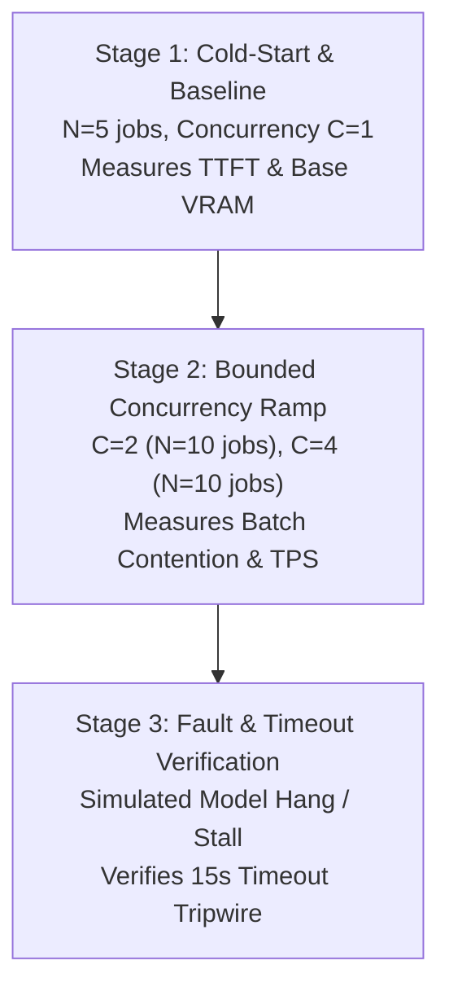

# SIIP GPU Inference Capacity and Load Benchmark Test Plan

**Document Version:** 1.0.0 (Phase 5.6)  
**Author:** SIIP Research & Engineering Pair  
**Status:** PROPOSED & BOUNDED (Awaiting Instructor Authorization for Execution)  
**Target Architecture:** Local Neural Inference Runtime (Qwen3-8B-Instruct via Ollama / vLLM)

---

## 1. Executive Summary & Purpose

The existing Phase 5.5 queue-drain benchmark (`scripts/measure_actual_reliability.py`) evaluates SQLite WAL concurrent queue locking and claim throughput under a deterministic CPU-fallback workload (yielding 60–75 jobs/sec). **These values represent database queue contention and lock acquisition speed, not GPU neural generation throughput.**

This test plan defines a **strictly bounded, safe experimental protocol** to measure actual local GPU inference capacity, latency distributions, and concurrency limits for Qwen3-8B without incurring API costs, causing host instability, or triggering out-of-memory (OOM) faults.

> [!WARNING]
> **Authorization Invariant:** As mandated by project rules, **no large inference load or full study (125 inferences) may be executed without explicit user authorization**. This plan is purely architectural and ready for execution upon directive.

---

## 2. Infrastructure & Model Specification

| Component | Target Specification | Minimum Bound |
| :--- | :--- | :--- |
| **Model** | `qwen2.5-coder:7b` / `qwen3:8b` (Q4_K_M / Q5_K_M) | 4-bit / 5-bit quantized |
| **Inference Engine** | Local Ollama (`http://127.0.0.1:11434`) or vLLM server | Loopback-only, no cloud APIs |
| **GPU Target** | NVIDIA RTX 3080/3090/4090 (16GB–24GB VRAM) or Apple M-series | $\ge$ 12GB VRAM available |
| **Host System** | Isolated local development workstation | Dedicated compute budget |
| **Telemetry** | `nvidia-smi` / PyTorch CUDA memory profiler | Periodic 500ms sampling |

---

## 3. Bounded Capacity Test Matrix

To prevent runaway resource utilization, testing is partitioned into three strictly bounded tiers totaling **no more than 25 total neural inferences**.



### Stage 1: Cold-Start and Baseline Latency ($N=5$, Concurrency $C=1$)
- **Objective:** Measure cold-start model load time, time-to-first-token (TTFT), tokens-per-second (TPS), and total generation latency under zero queue contention.
- **Payload:** 5 distinct synthetic student error states across `sql_join_01` to `sql_join_04` with InstructKG subgraphs.
- **Measured Metrics:**
  - `model_load_latency_ms` (cold start)
  - `time_to_first_token_ms` (TTFT)
  - `generation_throughput_tokens_per_sec` (TPS)
  - `total_inference_latency_p50_ms`, `total_inference_latency_p95_ms`
  - `peak_vram_mb`

### Stage 2: Bounded Concurrency Ramp ($C=2, C=4$; $N=10$ jobs per tier)
- **Objective:** Measure throughput degradation, GPU queueing delays, and VRAM scaling as concurrent worker processes claim jobs simultaneously.
- **Configuration A ($C=2$):** 2 worker threads draining a queue of 10 jobs.
- **Configuration B ($C=4$):** 4 worker threads draining a queue of 10 jobs.
- **Measured Metrics:**
  - `effective_jobs_per_minute`
  - `aggregate_tokens_per_sec`
  - `queue_wait_time_p50_ms`, `queue_wait_time_p95_ms`
  - `vram_headroom_mb`

### Stage 3: Fault Injection and Timeout Boundaries ($N=3$)
- **Objective:** Verify that neural engine stalls, GPU driver timeouts, or Ollama offline events are caught within the fail-closed threshold.
- **Execution:**
  - 1 job with artificial 20s network sleep $\to$ verify worker aborts at 15.0s lease timeout and increments retry count.
  - 1 job with Ollama process terminated $\to$ verify worker fails closed with deterministic baseline fallback and preserves student grade.
  - 1 job with malformed LLM response $\to$ verify JSON schema validator rejects corrupted output and logs observability event.

---

## 4. Safety Guardrails & Abort Tripwires

Execution will immediately abort if any of the following boundaries are breached:

1. **VRAM Utilization Tripwire:** If VRAM utilization exceeds **85%** of physical capacity, the test harness triggers `SIGINT` to worker pools to prevent host OS paging/freezing.
2. **Thermal Tripwire:** If GPU temperature exceeds **82°C**, workers pause for a 60-second cooldown.
3. **Volume Limit:** Total neural model calls across the entire test session **shall not exceed 30 requests**.
4. **Zero Paid API Access:** The benchmark script strictly asserts `SIIP_ALLOW_PAID_APIS == "0"` and binds exclusively to local loopback ports (`127.0.0.1`).
5. **Grade Isolation Invariant:** The benchmark harness asserts that under zero circumstances does a GPU timeout or model error alter a student's numerical score or deterministic observation.

---

## 5. Reporting Artifact Schema

The capacity benchmark will generate `artifacts/public-data/gpu_capacity_metrics.json` conforming to this schema:

```json
{
  "timestamp_utc": "ISO-8601",
  "hardware": {
    "gpu_device": "NVIDIA GeForce RTX ...",
    "total_vram_mb": 24576,
    "driver_version": "...",
    "cuda_version": "..."
  },
  "model": {
    "model_name": "qwen2.5-coder:7b",
    "quantization": "Q4_K_M",
    "context_window_tokens": 4096
  },
  "stage1_baseline": {
    "n_samples": 5,
    "cold_start_load_ms": 1250.0,
    "ttft_p50_ms": 180.0,
    "generation_tokens_per_sec": 42.5,
    "inference_latency_p50_ms": 3200.0,
    "inference_latency_p95_ms": 4100.0,
    "peak_vram_mb": 5800.0
  },
  "stage2_concurrency": {
    "c2_workers": {
      "jobs_per_minute": 32.0,
      "avg_queue_wait_ms": 450.0,
      "peak_vram_mb": 6400.0
    },
    "c4_workers": {
      "jobs_per_minute": 48.0,
      "avg_queue_wait_ms": 1150.0,
      "peak_vram_mb": 7600.0
    }
  },
  "stage3_resilience": {
    "lease_timeout_tripped_sec": 15.0,
    "fail_closed_baseline_fallback": true,
    "grade_mutation_count": 0
  }
}
```

---

## 6. Execution Pre-requisites & Authorization Protocol

Execution of this plan requires:
1. Professor Alawini's approval of the experimental bounding parameter ($N \le 25$).
2. Verification of local Ollama / vLLM availability on the test machine.
3. Execution via the controlled runner script:
   ```bash
   python scripts/benchmark_gpu_capacity.py --bounded-samples 25 --ack-local-gpu
   ```
