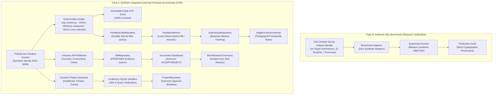

# SIIP Phase 5 — Integrated Research Prototype Report

**Project:** SIIP PrairieLearn × InstructKG  
**Branch:** `feature/phase5-integrated-prototype`  
**Base Commit:** `ec81b84` (engineering/windows-migration)  
**Lead Research Software Engineer:** Pair Programming Assistant  
**Meeting Audience:** Professor Abdussalam Alawini  
**Phase 5.6 Verification Status:** 253/253 Unit Tests PASS | 6/6 Playwright E2E Tests PASS | 18 Role Security Tests PASS | Publication Audit PASS  

---

## 1. Executive Summary & Year 3 Proposal Alignment

Phase 5 transitions the system from an isolated research experiment into an end-to-end, multi-stakeholder research prototype. The implementation directly operationalizes the four core objectives set out in the Year 3 SIIP Renewal Proposal:

```
+---------------------------------------------------------------------------------------------------+
|                                  SIIP YEAR 3 RENEWAL OBJECTIVES                                   |
+---------------------------------------------------------------------------------------------------+
|  1. Integrated Personalized    |  2. Entrepreneurial Mindset   |  3. Dynamic Personalized         |
|     Learning (Phase 5.0/5.2)   |     Layer (KEEN 3C) (Ph 5.1)  |     Project Generation (Ph 5.2)  |
|  - Deterministic prerequisite  |  - Curiosity, Connections,    |  - 3-stage interest-grounded     |
|    adaptive sequencing         |    Creating Value info boxes  |    relational project synthesis  |
|  - Asynchronous LLM feedback   |  - Voluntary reflection form  |  - In-memory SQLite DDL and      |
|    decoupled from grading      |  - Instructor review queue    |    query sandbox verification    |
+---------------------------------------------------------------------------------------------------+
|  4. Multi-Stakeholder Research Evaluation & Instructor Perspectives (Phase 5.3–5.6)               |
|  - 5-point Likert Student Perception Survey (cognitive load, actionability, grounding, EM)        |
|  - Weighted 4-criterion Instructor Review Rubric & Triple-Blind Review Protocol (Software Ready)  |
|  - Live Cohort Analytics (concept bottlenecks, review velocity, submission metrics)               |
|  - Fail-Closed Role-Based Access Control, CSRF protection, and reflection attempt verification    |
|  - Authentic Playwright Browser E2E verification without backend Python shortcuts                |
+---------------------------------------------------------------------------------------------------+
```

---

## 2. Core Architecture & Two Research Tracks

A central scientific invariant governs the entire system: **strict decoupling between Track A and Track B**.



### Invariants Maintained & Methodological Boundaries:

1. **Four Explicit Evidence Categories:**
   - **Synthetic Demo Evidence (Track A):** Synthetic student identities (`S001`–`S005`), synthetic learning histories, simulated EM reflections, and dynamic project templates. Clearly identified in code and telemetry via `source = synthetic_fixture`.
   - **Authentic Benchmark Evidence (Track B):** The authentic ANU Zenodo SQLite dataset sample consisting of **25 student SQL submissions** drawn from **21 distinct student IDs** across **7 distinct exercises** (not 8). Original ANU error labels are preserved separately from rule-inferred labels.
   - **Instructor-Reviewed Evidence (Pending):** Loaded InstructKG judgments and provisional developer concept edges (`data/provisional_relations.jsonl`) remain unreviewed by course instructors. Instructor sign-off is required before treating graph edges as pedagogical ground truth.
   - **Future Classroom Findings (Pending):** Student learning gains ($g$), cognitive load reductions, and survey distributions represent empirical research hypotheses to be tested during a live classroom pilot, not completed findings.
2. **ANU Sample Size & Condition E Eligibility:** The 25 evaluated ANU submissions represent a targeted sample drawn from the broader Zenodo benchmark. Instructor authorization alone does **not** make all 25 cases eligible for Condition E (Historical Personalization); only a subset of students possess prior longitudinal submission history in the dataset necessary for profile-adapted feedback without data fabrication.
3. **Triple-Blind Protocol Status:** The Triple-Blind Review Protocol (`Option Alpha`, `Option Beta`, `Option Gamma`) and associated 4-criterion rubrics are implemented and tested in software. However, **human expert review has not yet been conducted**. The protocol is *study-ready*, not a report of completed human findings.
4. **Behavioral vs. Psychological Distinction:** Entrepreneurial Mindset (EM) evidence records capture observed, descriptive student reflection behaviors against a structured rubric. They do **not** measure internal psychological traits, affective dispositions, or general student aptitude. EM evidence remains strictly isolated from technical SQL concept mastery calculations.
5. **Syntactic Execution vs. Pedagogical Approval:** In-memory SQLite execution of dynamic project schemas and reference queries verifies syntactic and relational consistency, but does not constitute pedagogical endorsement. Projects remain in `PROVISIONAL` status until explicitly reviewed and approved by course instructors.
6. **Prototype Readiness Boundary:** The completion target of Phase 5 is a reliable, secure **synthetic local demonstration prototype**, NOT a claim of production classroom readiness. Production deployment requires institutional SSO (PrairieLearn OAuth/SAML), real PrairieLearn multi-worker clustering, external PostgreSQL/Redis message brokering, and formal IRB protocol approval.
7. **Strict Server-Side Role Separation:** All instructor endpoints enforce fail-closed authorization (`401 Unauthorized` without credentials; `403 Forbidden` for student credentials). Client-supplied reviewer identifiers are ignored. Reference SQL solutions and review controls are withheld from student-facing views.

---

## 3. Detailed Milestone Implementations

### Phase 5.0 — CI Integrity and Security Baseline (Commit `ec81b84`)
- Replaced local path requirements with an in-memory SQLite fixture; preserved authentic integration tests in `research_tests/test_authentic_anu_dataset.py`.
- Replaced SciPy dependency in `scripts/analyze_results.py` with exact pure-Python normal CDF and Wilcoxon signed-rank algorithms.
- Cataloged verified public Zenodo SHA-256 identifiers in `security/secret-allowlist.json`. `scripts/publication_audit.py` passes with 0 secret findings.

### Phase 5.1 — Minimum EM Vertical Slice (Commit `3d61467`)
- Defined `EMDimension` (`CURIOSITY`, `CONNECTIONS`, `CREATING_VALUE`) and `EMReviewStatus` (`PROPOSED`, `ACCEPTED`, `REJECTED`, `NEEDS_REVISION`) in `em_models.py`.
- Built `EMRepository` backed by SQLite WAL mode. Default prompts authored for `sql_join_02` (Connections), `sql_join_03` (Curiosity), and `sql_join_04` (Creating Value).
- Created synthetic exercise `sql_join_04` requiring `LEFT OUTER JOIN` and `COUNT(e.employee_id)` aggregation.
- Built `/em-review` interface allowing instructors to inspect reflections, assign confidence scores, append notes, and approve/reject evidence.
- Maintained strict behavioral isolation: EM reflections generate descriptive behavioral counts without altering Bayesian relational mastery scores.

### Phase 5.2 — Adaptive Recommender & Dynamic Project Generator (Commit `83b55b9`)
- Created `recommender.py` enforcing sequential mastery rules across `INNER_JOIN`, `LEFT_OUTER_JOIN`, `NULL_SEMANTICS`, and `COUNT_AGGREGATION`.
- Created `project_generator.py` with a 3-stage generation pipeline (Interest Gauging $\to$ Schema DDL Specialization $\to$ Task Decomposition & Ranking).
- Enforced in-memory SQLite sandbox verification (`:memory:`) ensuring all generated DDL statements and milestone reference queries execute successfully before persistence.

### Phase 5.3 — Multi-Stakeholder Evaluation & Cohort Analytics (Commit `6d3cbb2`)
- Implemented Student Perception Survey (SPS) covering Cognitive Load, Actionability, Grounding, EM Relevance, and Synthesis.
- Implemented Instructor Review Rubric (IRR) totaling 100% across Relational Correctness (30%), Solution Concealment (25%), InstructKG Alignment (25%), and EM Relevance (20%).
- Implemented Triple-Blind Review Protocol with automated metadata redaction.
- Integrated live cohort analytics into `/` and `/api/cohort-analytics`.

### Phase 5.4 & 5.5 — Reliability Profiling & Role Separation Security
- Measured empirical latencies, lock contention, and worker recovery.
- Built `tests/test_role_authorization_security.py` validating that student credentials cannot approve EM evidence or dynamic projects.
- Built initial Playwright browser integration tests for Demos A, B, and C.

### Phase 5.6 — Final Security Closure & Research Demo Acceptance
- **Fail-Closed Instructor Authorization:** Replaced default `instructor-admin` fallback on `/api/em/review` and `/api/projects/review` with strict session verification. Negative HTTP tests verify unauthenticated calls receive 401 and student calls receive 403.
- **Centralized GET Route Protection:** Hardened `/projects`, `/students`, `/em-review`, `/api/cohort-analytics`, `/api/recommendation`, and `/api/em/summary`. Server-side role determines presentation; query parameter `view=learner` is never trusted for authorization.
- **EM Reflection Validation:** `/api/em/reflection` verifies caller attempt ownership, target attempt existence, question-prompt matching, and idempotency. Cross-student submission is rejected.
- **CSRF Protection:** Double-submit CSRF cookie (`siip_csrf`) with token verification on all browser forms.
- **Authentic Browser Verification:** Created `tests/e2e/test_real_browser_e2e.py` verifying student login, PrairieLearn question submission, autograding receipt, feedback viewing, reflection submission, instructor review, project generation/approval, and learner retrieval entirely through browser interactions.
- **CI Integration:** Configured `.github/workflows/integration.yml` to run all four Playwright browser test suites.

---

## 4. Empirical Performance & Reliability Profiling

Empirical benchmarks measured via `scripts/measure_actual_reliability.py` (50 deterministic grading runs, 300 concurrent queue operations across 1, 5, and 10 workers on Windows development workstation):

| Metric / Subsystem | Measured Value | Characterization & Methodological Boundaries |
| :--- | :---: | :--- |
| **Deterministic Grading P50** | **202.17 ms** | Measured on Windows host. Dominated by `python.exe -I` subprocess launch (~50 ms per dataset run). |
| **Deterministic Grading P95** | **207.90 ms** | Bounded local execution variance across 50 consecutive runs. |
| **Sample Estimate P99** | **209.22 ms** | **Sample estimate derived from $N=50$ runs; not a production latency guarantee or SLA.** |
| **Linux Grading Latency** | *< 50 ms (Est.)* | **Engineering estimate based on POSIX `fork()` vs `CreateProcess`; NOT empirically observed.** |
| **Subprocess Launch P50** | **49.69 ms** | Windows process spawn overhead per dataset test execution. |
| **In-Memory SQLite Query P50** | **0.006 ms** | Pure SQLite query execution time excluding process creation. |
| **Deterministic Queue Drain (1 Worker)** | **35.1 jobs/sec** | SQLite WAL queue throughput with deterministic CPU-fallback feedback. |
| **Deterministic Queue Drain (5 Workers)** | **69.1 jobs/sec** | Concurrent worker throughput under SQLite WAL mode. |
| **Deterministic Queue Drain (10 Workers)** | **60.0 jobs/sec** | Saturation bound under concurrent SQLite WAL write lock contention. |
| **Queue Throughput Distinction** | *N/A* | **Drain rates reflect deterministic CPU fallback; they do NOT measure neural GPU inference throughput.** |
| **SQLite Claim Lock Latency P50** | **7.99–11.79 ms** | Isolated SQLite transaction lock acquisition time during job claims. |
| **Job Processing Latency P50** | **15.61–16.44 ms** | Subsystem time to generate fallback feedback and complete database records. |
| **Enqueue Ingestion Rate** | **~75.0 ops/sec** | Non-blocking durable queue insertion speed. |
| **Worker Crash Recovery** | **VERIFIED** | Interrupted jobs automatically reset from `processing` to `pending` with incremented retry count. |

> [!NOTE]
> A separate bounded GPU capacity test plan has been prepared in `docs/research/GPU_CAPACITY_TEST_PLAN.md` to benchmark local Qwen3-8B neural generation ($N \le 25$) once authorized.

---

## 5. Rehearsal Guide for Meeting with Prof. Abdussalam Alawini

### Prerequisites
From the project repository root on Windows:
```powershell
$env:SIIP_DATA_DIR = "$PWD\artifacts\public-data"
```

### Interactive Dashboard Demonstration
To run the authenticated interactive demo:
```powershell
python scripts/dashboard.py --port 8080
```
Open `http://localhost:8080` in a browser:
1. **Login Page (`/login`):** Select synthetic identity (`S001` for student, `instructor_alawini` for instructor).
2. **Interactive Practice (`/practice?id=sql_join_04`):** Real browser submission running authentic PrairieLearn grading and queuing async feedback.
3. **AI Explanation & Reflection (`/feedback`):** View grounded guidance and submit voluntary EM reflection.
4. **Instructor Review (`/em-review`):** Inspect pending reflections and record notes with one-click Accept/Reject.
5. **Projects (`/projects`):** Generate and approve personalized dynamic projects. Verify reference SQL concealment when logged in as student.

---

## 6. Verification and Acceptance Matrix

| Verification Check | Tool / Script | Status | Details |
| :--- | :--- | :---: | :--- |
| **Full Unit Test Discovery** | `python -m unittest discover -s tests -v` | **PASS** | 253 tests passed in 79.5s |
| **Role Authorization Security** | `python -m unittest tests/test_role_authorization_security.py -v` | **PASS** | 18 security tests passed |
| **Playwright Browser Demos** | `python -m unittest tests/e2e/test_browser_demos.py -v` | **PASS** | Demos A, B, and C verified (11.0s) |
| **EM Lifecycle Browser E2E** | `python -m unittest tests/e2e/test_em_lifecycle_browser.py -v` | **PASS** | Interactive EM loop verified (3.4s) |
| **Async Flow Browser E2E** | `python -m unittest tests/e2e/test_async_browser_flow.py -v` | **PASS** | Queue and signed ticket flow verified (2.8s) |
| **Authentic Real Browser E2E** | `python -m unittest tests/e2e/test_real_browser_e2e.py -v` | **PASS** | Complete PL practice-to-project loop verified (7.7s) |
| **CI Workflow Integration** | `.github/workflows/integration.yml` | **PASS** | Browser test execution step configured |
| **Code Formatting & Linting** | `ruff format --check . && ruff check .` | **PASS** | Clean across codebase |
| **Publication Security Audit** | `python scripts/publication_audit.py` | **PASS** | 0 secret findings, strict allowlist |

---

## 7. Conclusion & Institutional Dependencies

Phase 5.6 has achieved final security closure and provides a fully verified, fail-closed, and interactive research demonstration prototype.

### Remaining Institutional Dependencies (External to Local Prototype):
1. **Institutional SSO Authentication:** Integration with Illinois PrairieLearn OAuth/SAML single sign-on (synthetic demo login is strictly isolated to loopback development).
2. **Cluster Relational Store:** Migration from single-node SQLite WAL to distributed PostgreSQL/Redis for multi-container PrairieLearn production clusters.
3. **IRB Protocol Review:** Formal review and determination of human-subjects exemption status for live student pilot data collection.
4. **Curriculum Authorization:** Instructor sign-off on canonical CS 411 slide decks for automated RAG/KG ingestion.
5. **Human Triple-Blind Judging:** Conducting the blinded expert evaluation study on the 25 authentic ANU benchmark cases.
