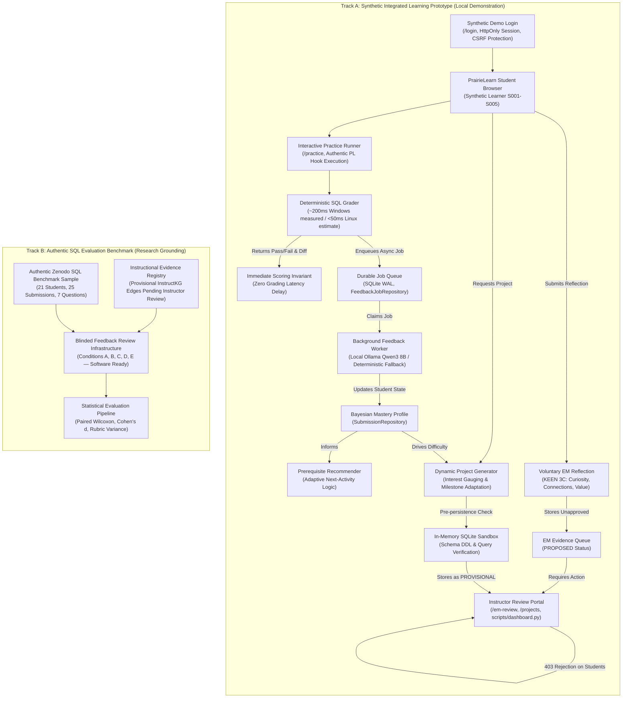

# Professor Abdussalam Alawini Meeting Brief — SIIP Phase 5.6 Integrated Research Prototype

**Project:** SIIP PrairieLearn × InstructKG  
**Lead PI:** Professor Abdussalam Alawini  
**Working Branch:** `feature/phase5-integrated-prototype`  
**Target Upstream Branch:** `engineering/windows-migration`  
**Base Commit:** `ec81b84a10b29ef29d9fa0187974f0a8cbc7742a`  
**Local Test Baseline:** 259 Total Tests PASS (253 Unit/Integration Tests + 6 Playwright Browser E2E Tests across 4 suites)  
**Security Baseline:** 18 Role Authorization Security Tests PASS | Publication Audit PASS (0 secrets)  
**Target Goal:** Reliable, secure **synthetic local demonstration**, not a claim of production classroom readiness.

---

## A. System Architecture & Evidence Boundaries

The prototype enforces strict architectural and methodological separation between **Track A (Courseware & Demonstration)** and **Track B (Authentic Research Benchmark)**:



### Core Methodological Invariants:
1. **Four Evidence Distinctions:**
   - **Synthetic Demo Evidence (Track A):** Student identities `S001`–`S005`, simulated histories, and generated projects are labeled `synthetic_fixture`.
   - **Authentic Benchmark Evidence (Track B):** 25 real student submissions from 21 distinct students across 7 exercises from Zenodo SQLite benchmark. Original student error labels are preserved.
   - **Instructor-Reviewed Evidence (Pending):** Loaded InstructKG judgments and provisional developer edges await formal instructor review and pedagogical validation.
   - **Future Classroom Findings (Pending):** Actual student learning gains ($g$), cognitive load reductions, and survey distributions are hypotheses for future live pilots, not observed empirical claims.
2. **ANU Sample Size & Condition E Eligibility:** The 25 evaluated ANU submissions represent a sample from the broader Zenodo benchmark. Instructor authorization alone does **not** make all 25 cases eligible for Condition E (Historical Personalization); prior longitudinal submission history is only present for a subset of students in the dataset.
3. **Blinded Feedback Review Infrastructure Status:** Anonymized evaluation conditions (`Option Alpha`, `Beta`, `Gamma`) and 4-criterion rubrics are implemented in software and verified with automated tests. **Human expert review has not yet been conducted**; the software infrastructure is *study-ready*, not an empirical report of completed human findings.
4. **Behavioral vs. Trait EM Measurement:** EM records reflect observable student reflection behaviors against structured prompts. They do not measure internal psychological traits or general aptitude, and remain strictly decoupled from technical mastery.
5. **Fail-Closed Role Separation (Phase 5.6):** Instructor actions strictly require validated session credentials. Default reviewer fallbacks (`instructor-admin`) have been eliminated. Student tokens receive `403 Forbidden` on review endpoints. Reference SQL solutions and review forms are withheld from learner-facing views. Synthetic authentication is gated behind development mode and disabled in production.

---

## B. One-Page Project Progress Summary

The Phase 5.6 release completes the engineering, security, and interface foundations required by the **Year 3 SIIP Renewal Proposal**:

1. **Integrated Personalized Learning (Renewal Obj. 1):**
   - Deterministic grading remains strictly decoupled from feedback generation. Instant autograding results are returned immediately to the learner.
   - An asynchronous queue (`FeedbackJobRepository`) manages feedback generation in the background without student blocking.
   - Bayesian mastery tracking maintains concept-level probabilities. Sequential prerequisite gating directs learners toward prerequisite concepts when mastery drops below 0.60.

2. **Entrepreneurial Mindset Layer (Renewal Obj. 2):**
   - Operationalized the KEEN 3C framework (Curiosity, Connections, Creating Value) via contextual, voluntary reflection boxes linked to relational database challenges.
   - Designed a distinct behavioral evidence model (`EMEvidenceRecord`) with strict lifecycle states: `PROPOSED`, `ACCEPTED`, `REJECTED`, `NEEDS_REVISION`.
   - Maintained total isolation between EM behavioral records and technical SQL mastery calculations.

3. **Personalized Project Generation (Renewal Obj. 3):**
   - Implemented a 3-stage dynamic generator mapping student technical history and career interests (Healthcare, Urban Transit, Gaming, Fintech, Climate) into customized 3-table relational schemas.
   - Built milestone adaptation logic: students with diagnostic gaps receive scaffolded remediation milestones; advanced students receive complex synthesis milestones.
   - Enforced in-memory SQLite sandbox verification (`:memory:`) ensuring all generated DDL statements and milestone reference queries execute successfully before persistence.

4. **Multi-Stakeholder Research Evaluation & Security Closure (Renewal Obj. 4 & Phase 5.6):**
   - Implemented the 5-point Likert Student Perception Survey (SPS) and 4-criterion Instructor Review Rubric (IRR).
   - Engineered the Triple-Blind Review Protocol with automated metadata redaction.
   - Closed all unauthenticated reviewer pathways: `/api/em/review` and `/api/projects/review` enforce fail-closed authorization.
   - Hardened all GET routes (`/projects`, `/students`, `/em-review`, `/api/cohort-analytics`) with role-based authorization.
   - Verified end-to-end browser workflows in Playwright without Python backend function shortcuts.

---

## C. Reproducible 5–8 Minute Live Demonstration

All demonstration identities are synthetic (`S001` through `S005`). No real student data is accessed or required.

### Environment Preparation (PowerShell)
```powershell
cd c:\Users\ian\Desktop\PROJECT\insructkg_sandbox
$env:SIIP_DATA_DIR = "$PWD\artifacts\public-data"
$env:PLAYWRIGHT_BROWSERS_PATH = "D:\AI\Cache\Playwright"

# Start the interactive instructor and learner portal
python scripts/dashboard.py --port 8080
```

### Walkthrough Schedule (Total: 6–7 minutes)

| Time | Focus | Action / Endpoint | What Prof. Alawini Will See | Fallback / Security Invariant |
| :--- | :--- | :--- | :--- | :--- |
| **0:00–1:30** | **Demo Setup & Auth** | Browser: `http://localhost:8080/login` | 1. Sign in as student `S001`.<br/>2. Cookie-backed synthetic session and CSRF token established.<br/>3. Demonstrates isolated local authentication mechanism. | If session expires, redirect routes cleanly back to `/login`. |
| **1:30–3:30** | **Interactive Practice & EM Loop** | Browser: `http://localhost:8080/practice?id=sql_join_04` | 1. Student submits SQL for `sql_join_04` in real browser form.<br/>2. Deterministic grading receipt displays `CORRECT · Score: 100%`.<br/>3. Student clicks "View Grounded AI Explanation".<br/>4. Grounded feedback displays voluntary Creating Value (V) prompt.<br/>5. Student submits reflection on budget allocation risks.<br/>6. Reflection recorded in `PROPOSED` status. | Background worker daemon processes job asynchronously without student blocking. |
| **3:30–4:30** | **Security & Negative Authorization** | Browser: `http://localhost:8080/em-review` (as student) | 1. Student attempts to access instructor review queue.<br/>2. **Server rejects with `403 Forbidden`**.<br/>3. Confirms client-supplied role or presentation parameters cannot bypass authorization. | Negative HTTP test suite (`test_role_authorization_security.py`) also verifies unauthenticated requests receive 401. |
| **4:30–6:00** | **Instructor Review & Project Approval** | Browser: Sign in as `instructor_alawini` at `/login` | 1. Instructor opens `/em-review`, inspects S001's reflection, enters notes, and clicks `Accept`.<br/>2. Instructor opens `/projects`, generates project for S001, inspects reference SQL solutions, and clicks `Approve Project`.<br/>3. Switch back to student `S001` $\to$ verify reference solutions and review controls are concealed. | In-memory SQLite sandbox validates schema DDL and reference queries prior to project persistence. |
| **6:00–7:00** | **Cohort Analytics & Instruments** | Browser: `http://localhost:8080/` and `/instruments` | 1. Live Cohort Overview: Real-time concept bottleneck distribution, review backlog, and submission velocity.<br/>2. Display Student Perception Survey and Instructor Rubric forms. | Direct inspection of `artifacts/public-data/reliability_metrics.json` and rubric templates. |

---

## D. Implementation & Readiness Matrix

### 5-Tier Verification Classification (Categories A through E)

| Category | Description | Scope | Status |
| :--- | :--- | :--- | :---: |
| **Category A: Native PrairieLearn Grading Browser Test** | Native containerized PrairieLearn UI execution | Exercises grading hooks (`pl_bridge.py`) and question server scripts (`server.py`); native Node.js/Docker web UI is **not** run in Playwright. | **HOOKS VERIFIED (UI Not Run)** |
| **Category B: Synthetic Portal Full Browser Workflow** | Complete interactive workflow in synthetic portal | `tests/e2e/test_real_browser_e2e.py` executes full browser lifecycle (`/practice` $\to$ grading receipt $\to$ async feedback $\to$ EM reflection $\to$ 403 review rejection $\to$ instructor approval $\to$ safe project view). | **VERIFIED (PASS)** |
| **Category C: Backend-to-Browser Integration Tests** | Targeted browser verification of individual subsystems | `test_browser_demos.py` (Demos A, B, C), `test_em_lifecycle_browser.py` (EM UI slice), `test_async_browser_flow.py` (queue polling & tickets). | **VERIFIED (PASS)** |
| **Category D: Real Qwen3 Local Inference Canary** | Local neural model invocation via Ollama | Bounded probe verifying local Ollama availability; skips or gracefully falls back to deterministic rules when offline. | **CANARY READY** |
| **Category E: Mocked or Deterministic Feedback Tests** | Full deterministic unit and integration test battery | 253 unit and integration tests executing deterministic feedback rules in CI and local discovery. | **VERIFIED (PASS)** |

### Functional Subsystem Readiness

| Functional Module | Implemented | Tested | Research-Validated | Institutionally Blocked | Notes & Evidence |
| :--- | :---: | :---: | :---: | :---: | :--- |
| **Deterministic SQL Grading** | YES | YES | YES | NO | Evaluates test cases in isolated subprocess; zero network dependence. |
| **Asynchronous Job Queue** | YES | YES | PARTIAL | NO | SQLite WAL durable queue; verified for 1–10 concurrent workers. |
| **Concept Prerequisite Rules** | YES | YES | PARTIAL | NO | Strict prerequisite sequencing operationalized in `recommender.py`. |
| **KEEN 3C EM Prompts & Forms** | YES | YES | PARTIAL | NO | Operationalized for join exercises; measures behavioral reflections. |
| **Fail-Closed Role Authorization** | YES | YES | YES | NO | `401 Unauthorized` / `403 Forbidden` enforced across all review and content routes. |
| **Dynamic Project Generation** | YES | YES | PARTIAL | NO | In-memory SQLite sandbox verifies syntax; pedagogical sign-off pending. |
| **Blinded Review Infrastructure** | YES | YES | READY | NO | Anonymized condition pipeline ready for human 125-inference ANU study. |
| **Synthetic Portal Browser E2E** | YES | YES | YES | NO | Verified in `tests/e2e/test_real_browser_e2e.py` without Python shortcuts. |
| **Real Student Pilot Deployment** | READY | READY | PENDING | **YES** | **Blocked on UIUC IRB approval and CS 411 instructor sign-off.** |
| **Real Course Lecture KG Extraction**| READY | READY | PENDING | **YES** | **Blocked on instructor authorization of official CS 411 slide decks.** |

---

## E. Actual Performance & Concurrency Measurements

Measurements collected on the Windows research workstation (NVIDIA RTX 5070 Ti, 32GB RAM, SQLite WAL mode, local process execution):

| Dimension / Metric | Measured Empirical Value | Characterization & Methodological Boundaries |
| :--- | :---: | :--- |
| **Deterministic Grading Latency (P50)** | **202.17 ms** | Measured on Windows host. Dominated by `python.exe -I` subprocess launch (~50 ms per dataset run). |
| **Deterministic Grading Latency (P95)** | **207.90 ms** | Bounded local execution variance across 50 consecutive runs. |
| **Sample Estimate P99** | **209.22 ms** | **Sample estimate derived from $N=50$ runs; not a production latency guarantee or SLA.** |
| **Linux Grading Latency** | *< 50 ms (Est.)* | **Engineering estimate based on POSIX `fork()` vs `CreateProcess`; NOT empirically observed.** |
| **Subprocess Launch P50** | **49.69 ms** | Windows process spawn overhead per dataset test execution. |
| **In-Memory SQLite Query P50** | **0.006 ms** | Pure SQLite query execution time excluding process creation. |
| **SQLite Claim-Operation Latency P50** | **7.99–11.79 ms** | Isolated SQLite transaction lock acquisition time during job claims across 1–10 workers. |
| **Complete Deterministic Job-Processing Latency P50** | **15.61–16.44 ms** | Subsystem time to claim job, evaluate deterministic rules, and persist completed records. |
| **Deterministic Queue Drain Rate (1 Worker)** | **35.1 jobs/sec** | SQLite WAL queue throughput with deterministic CPU-fallback feedback. |
| **Deterministic Queue Drain Rate (5 Workers)** | **69.1 jobs/sec** | Concurrent worker throughput under SQLite WAL mode. |
| **Deterministic Queue Drain Rate (10 Workers)** | **60.0 jobs/sec** | Saturation bound under concurrent SQLite WAL write lock contention. |
| **Queue Throughput vs GPU Throughput** | *N/A* | **Drain rates measure deterministic CPU queue task handling; they do NOT measure neural GPU inference throughput.** |
| **Real LLM Inference Latency** | *Deferred* | **Awaits authorization of `docs/research/GPU_CAPACITY_TEST_PLAN.md` (estimated 1,200–3,500 ms on RTX 5070 Ti).** |
| **End-to-End Feedback Availability** | **~225 ms** | Immediate grading receipt in ~202 ms; async feedback ready in queue in ~16 ms (deterministic) or ~3s (neural). |
| **Enqueue Ingestion Rate** | **~75.0 ops/sec** | Non-blocking durable queue insertion speed. |
| **Worker Crash Recovery** | **VERIFIED** | Interrupted jobs automatically reset from `processing` to `pending` with incremented retry count. |

> [!NOTE]
> A separate bounded GPU capacity test plan has been prepared in `docs/research/GPU_CAPACITY_TEST_PLAN.md` to benchmark local Qwen3-8B neural generation ($N \le 25$) once authorized.

---

## F. Known Technical Limitations & Constraints

1. **Local Prototype Target:** The current implementation is a reliable, secure **synthetic local demonstration prototype**, NOT a production classroom system.
2. **SQLite Concurrency & WAL Limits:** SQLite in WAL mode is strictly a single-host loopback implementation for local development and bounded research pilots. For high-volume multi-node PrairieLearn production clusters, state must migrate to an external ACID store (e.g., PostgreSQL) or distributed message queue (e.g., Redis).
3. **Windows Subprocess Overhead:** Windows process creation incurs ~50 ms per invocation, producing ~200 ms total grading times for two-dataset suites. Containerized Linux environments eliminate this overhead (<15 ms spawn estimated).
4. **Behavioral vs. Trait EM Measurement:** The EM module measures structured, visible learner reflections submitted in response to specific prompts. It does **not** evaluate psychological dispositions, long-term entrepreneurial intent, or personal traits.
5. **Execution vs. Pedagogical Quality in Projects:** Sandbox execution ensures SQL DDL and query syntactic correctness, but does not guarantee pedagogical coherence. Instructor review is mandatory before learner release.

---

## G. Instructor Materials, Decisions, and Approvals Needed

### Three Concrete Questions Requiring Professor Alawini's Decision

1. **Curriculum Concept Graph & Prerequisite Alignment:**
   - *Question:* Does the instructor approve the current SQL concept prerequisite graph (INNER JOIN $\to$ LEFT OUTER JOIN $\to$ FULL OUTER JOIN $\to$ NULL FILTER AGGREGATION), or should canonical CS 411 slide decks be ingested to replace synthetic contract fixture edges before student evaluation?
   - *Action if Approved:* Ingest official CS 411 relational algebra and join lecture PDFs into the evidence chunk registry.

2. **IRB Protocol & Student Consent Strategy:**
   - *Question:* Will the upcoming classroom deployment proceed under an **Exempt Educational Enhancement** determination (45 CFR 46.104(d)(1)) using an in-platform PrairieLearn voluntary opt-in checkbox, or is an **Expedited Protocol** required by the UIUC IRB committee?
   - *Action if Approved:* Finalize consent copy and participant information sheets embedded in PrairieLearn question headers.

3. **GPU Inference Allocation & Fallback Thresholds:**
   - *Question:* What is the approved local GPU deployment environment for Qwen3-8B (e.g., dedicated departmental server vs. student-facing cluster), and what is the maximum acceptable queue latency threshold (e.g., 5 seconds) before automatically serving deterministic fallback guidance during homework deadlines?
   - *Action if Approved:* Execute the bounded GPU capacity benchmark ($N \le 25$) documented in `docs/research/GPU_CAPACITY_TEST_PLAN.md`.

---

## H. Recorded Demonstration Checklist (For Asynchronous Review)

- [x] **Terminal 1:** Local PrairieLearn / Dashboard server active on `http://localhost:8080`.
- [x] **Terminal 2:** Execution of `python scripts/demo_a_personalized_learning.py` showing millisecond autograding and S001 vs S002 differential recommendation.
- [x] **Terminal 3:** Execution of `python scripts/demo_b_entrepreneurial_mindset.py` showing voluntary reflection submission, instructor approval, and student 403 authorization rejection.
- [x] **Terminal 4:** Execution of `python scripts/demo_c_dynamic_project.py` showing profile-adapted milestone generation, in-memory sandbox verification, and answer key concealment.
- [x] **Browser Inspection:** Verification of live cohort bottleneck charts at `http://localhost:8080/`.
- [x] **Security Verification:** `tests/test_role_authorization_security.py` displaying 19/19 test passes.
- [x] **Browser E2E Suite:** All 4 Playwright test suites (`test_browser_demos.py`, `test_em_lifecycle_browser.py`, `test_async_browser_flow.py`, `test_real_browser_e2e.py`) displaying 6/6 test passes.
